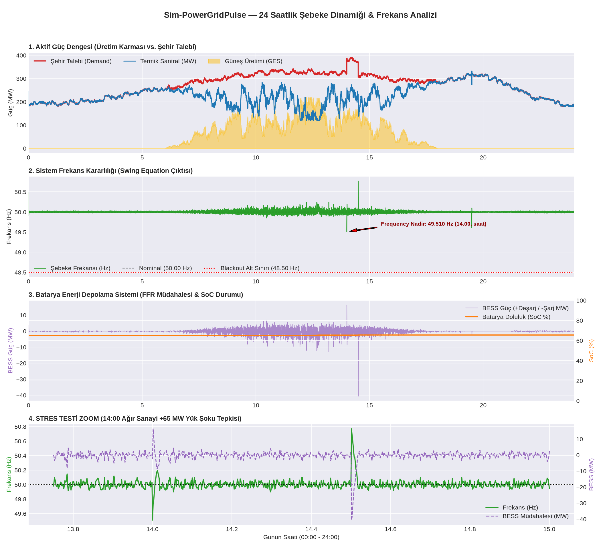

# Sim-PowerGridPulse ⚡

**Sim-PowerGridPulse**, yenilenebilir enerji entegrasyonu yüksek (düşük ataletli) bir elektrik iletim şebekesinde **Frekans Kararlılığı (Frequency Stability)**, **Hiyerarşik Otomatik Üretim Kontrolü (AGC)** ve **Merit Order Ekonomik Yük Dağıtımı (Economic Dispatch)** dinamiklerini simüle eden, Clean Architecture prensipleriyle geliştirilmiş bir Digital Twin motorudur.



---

## 1. Matematiksel ve Fiziksel Model

Simülatör, $dt = 1.0\text{ s}$ zaman çözünürlüğünde ($86.400\text{ adım/gün}$) aşağıdaki diferansiyel denklemleri ve donanım kısıtlarını çözer:

* **Swing Equation (Salınım Denklemi) & RoCoF:**
  $$\frac{df}{dt} = \text{RoCoF} = \frac{f_0}{2 \cdot H \cdot S_{\text{base}}} \left( P_{\text{gen}} - P_{\text{load}} - P_{\text{damping}} \right)$$
* **Birincil Frekans Kontrolü (Primary Droop Control — $R = \%5$):**
  Senkron jeneratörlerin merkezi komut beklemeden yerel hız regülatörleri (Governor) üzerinden frekans sapmasına anlık tepki vermesi.
* **Türbin Gecikmesi ve Mekanik Sınırlar:**
  Her termik ünite birinci dereceden gecikme ($\tau_g$, First-Order Lag) ve maksimum güç değişim hızı (**Ramp-Rate**, $\text{MW/s}$) kısıtları altında çalışır.
* **Batarya Enerji Depolama Sistemi (BESS):**
  $\tau = 0.2\text{ s}$ inverter tepki süresi, tek yönlü çevrim verimliliği ($\eta = \%92$) ve SoC (State of Charge) koruma kilitleri ile **Fast Frequency Response (FFR)** ve **Synthetic Inertia** sağlar.

---

## 2. Sistem Mimarisi (Clean Architecture)

```text
Sim-PowerGridPulse/
├── core/                      # Domain Katmanı (Sıfır dış bağımlılık)
│   ├── physics_engine.py      # Swing Equation ve UFLS/Blackout koruma rölesi
│   ├── generators.py          # Thermal, BESS ve Solar fiziksel modelleri
│   └── controllers.py         # Hiyerarşik AGC (PI + Anti-Windup) & Merit Order Dispatcher
├── infrastructure/            # Altyapı Katmanı
│   └── telemetry_repo.py      # SQLite Historian (Batch Insert veri kaydı)
├── visualization/             # Sunum / SCADA Katmanı
│   └── scada_plotter.py       # 4 panelli osiloskop ve frekans analiz grafiği
├── tests/                     # Doğrulama Katmanı
│   └── test_grid_mechanics.py # Fiziksel korunum, Ramp-Rate ve N-1 birim testleri
└── main.py                    # Simülasyon Orkestratörü